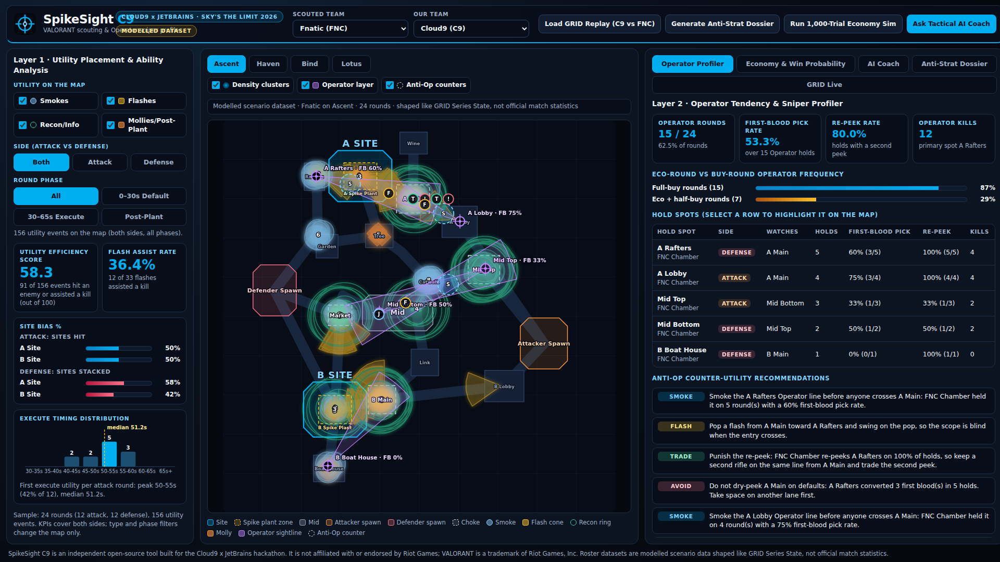
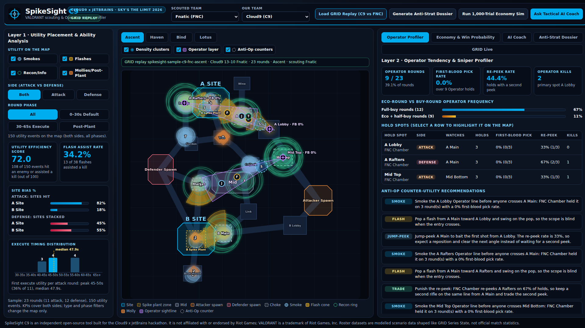
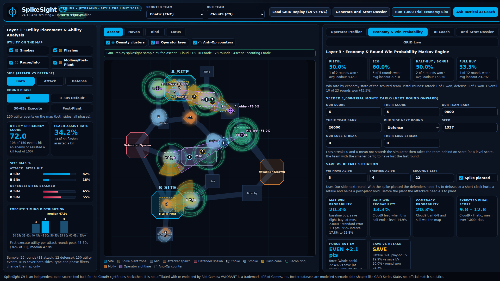
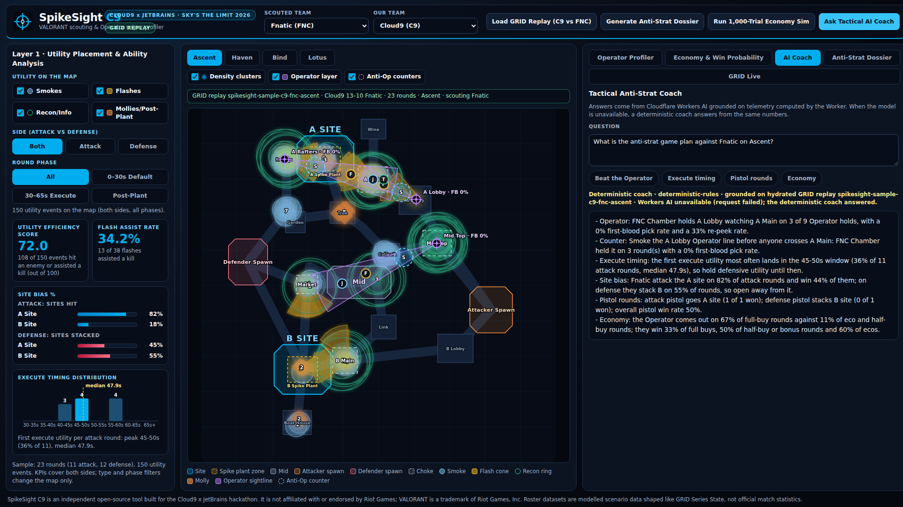

# SpikeSight C9

**VALORANT and Game Changers tactical scouting and Operator sniper profiler**, built for the Cloud9 x JetBrains "Sky's The Limit" Hackathon 2026, Category 1.

SpikeSight C9 is a single-screen coaching dashboard. It draws four competitive maps as top-down SVG layouts and puts three analysis layers on them: where and when a team throws utility, where its Operator player holds and how to counter each hold, and what the economy says about the rest of the map. It hydrates a GRID-shaped replay in one click, proxies live GRID GraphQL with your own key, exports a Markdown anti-strat dossier, and answers coaching questions from the numbers on screen.

- **Live app:** [spikesight-c9.bedir-ai.workers.dev](https://spikesight-c9.bedir-ai.workers.dev)
- **Health:** [/health](https://spikesight-c9.bedir-ai.workers.dev/health)
- **Sample series:** [/api/grid/sample-series](https://spikesight-c9.bedir-ai.workers.dev/api/grid/sample-series)

It is a Cloudflare Worker in plain JavaScript ES modules with static assets. There is no bundler configuration and there are no npm dependencies.

## The three layers

| Layer | What you see | What is computed |
| --- | --- | --- |
| 1. Utility Placement and Ability Analysis | Smoke circles, flash cones, recon rings, molly markers and density clusters on the map. Toggles for Smokes, Flashes, Recon/Info and Mollies/Post-Plant, a side filter (Both, Attack, Defense) and a round phase filter (0 to 30 s Default, 30 to 65 s Execute, Post-Plant). | Utility Efficiency Score, Flash Assist Rate, Execute Timing Distribution with its median, Site Bias % per side. |
| 2. Operator Tendency and Sniper Profiler | Hold spots with sightline cones, a hold spot table, and anti-Operator counter markers (smoke, flash, trade, jump-peek, avoid). Selecting a table row highlights the spot. | Holds, first-blood pick rate and re-peek rate per spot, Operator frequency on full-buy rounds against eco and half-buy rounds, ranked counter recommendations. |
| 3. Economy and Round Win-Probability Markov Engine | Win rate per economy state (Pistol, Eco, Half-Buy / Bonus, Full Buy), a simulator form and a final score distribution chart. | Seeded 1,000-trial Monte Carlo: map win probability with standard error and 95% interval, half win probability, comeback probability, force-buy EV with a FORCE / SAVE / EVEN call, and a save-versus-retake call with its reasoning (RETAKE on defense; HOLD or EXECUTE when the same situation is played on attack or before the plant). |

Maps: Ascent, Haven, Bind and Lotus, each with site zones, spike plant zones, attacker and defender spawns and chokes. Ascent, Haven and Lotus have a Mid zone; Bind has its two teleporters instead. The maps are schematics: every zone is a box or an octagon centred on the real callout position and corridors are straight links between callouts. Walls, angles and cover are not drawn.

Rosters: Cloud9, Cloud9 White / GC, Sentinels, G2 Esports, Fnatic and PRX, each with a modelled 24-round dataset per map (see Data provenance).

## Metric formulas

These are the formulas in `public/js/scout-engine.js`. Each one is written in a comment above its function.

- **Utility Efficiency Score** = 100 x (utility events with `enemiesAffected >= 1` or `assistedKill` true) / (all utility events). Range 0 to 100, one decimal.
- **Flash Assist Rate** = (flashes with `assistedKill` true) / (all flashes).
- **Execute Timing Distribution**: for every attack round, the time of its first execute-phase utility event (30 s or later and before the plant), counted into the buckets 30-35s, 35-40s, 40-45s, 45-50s, 50-55s, 55-60s, 60-65s and 65s+. Share = bucket count / rounds with such an event. The median is the median of those times.
- **Site Bias %**, attack: attack rounds whose attacked site is S / attack rounds with a site. The attacked site is `plantSite`, or the most frequent site of the round's execute-phase utility when there was no plant.
- **Site Bias %**, defense: defense rounds whose stacked site is S / defense rounds with a site. The stacked site is the most frequent site among default-phase utility and Operator hold spots.
- **Round phase**: `postPlant` true or `time >= plantTime` is Post-Plant, otherwise `time < 30` is Default, otherwise Execute.
- **Density clusters**: greedy leader clustering in input order. An event joins a cluster of the same type when it is within the radius (0.05 of the map) of the running centroid.
- **Operator spot rates**: first-blood pick rate = first bloods / holds; re-peek rate = re-peeks / holds. Buy-round Operator frequency = full-buy rounds with a hold / full-buy rounds; eco-round frequency = the same over eco and half-buy rounds.
- **Sightline**: a point is in the cone when its distance is within `range` and its angle to the sightline is at most `fovDeg / 2`.
- **Anti-Operator counters**: the smoke sits 35% and the flash 75% of the way from the hold spot to the callout it watches. A trade (re-peek punish) is recommended only when the re-peek rate is above 0.5, a jump-peek only when it is 0.5 or below, and "avoid" when a spot has at least 2 holds and a first-blood pick rate of 0.5 or more.
- **Economy state**: Pistol for rounds 1 and 13, otherwise Eco below 5,000, Half-Buy / Bonus from 5,000 to 19,999 and Full Buy from 20,000 of team loadout value.

## The Monte Carlo model

The simulator is a model, not a fit to measured match data. Its inputs are the two scores, the two team banks, the two loss streaks, our side for the next round, the map, a per-round strength edge taken from the two rosters, the number of trials (1,000) and a seed.

Starting state: exactly one team won the previous round. A team on a loss streak of 0 whose opponent is on a streak above 0 is that winner. When both streaks are 0 (the form's default, meaning "not stated") the loser is derived, which is an assumption: the team behind on score, or at a level score the team with the smaller bank, starts on a loss streak of 1. The results name the streaks that were used and say when they were derived. Pistol rounds reset both streaks.

Each simulated round:

1. Rounds 1 and 13 are pistol rounds with a team bank of 4,000. Every overtime round sets both banks to 25,000.
2. Both teams buy. A team that can afford it tops up to a 21,500 full buy. Otherwise it spends 70% of its bank after a won round, or saves with a 2,000 light buy. Rounds 12 and 24, overtime rounds and rounds where the opponent is on 12 are must-buy rounds, in which a team that cannot afford the full buy spends its whole bank.
3. The round win probability is `ROUND_WIN_MATRIX[our economy][their economy]`, plus the map's attack edge when we attack (minus when we defend), plus the strength edge, clamped to 0.02 to 0.98.
4. Credits follow the VALORANT rules scaled to five players: a win pays 15,000 plus 1,000 kill money, a loss pays 9,500, 12,000 or 14,500 by loss streak plus 400, a plant pays the attackers 1,500, and the team bank is capped at 45,000. The winner carries 60% of its loadout into the next round and the loser 10%.
5. Sides swap after round 12 and before every overtime round. The map ends at 13 with a two-round lead. After 12 overtime rounds sudden death applies: the first lead decides the map (19-18 from 18-18), so no trial ends level. The form accepts scores up to 18, the highest a live map can show.

Round win matrix (row is our economy, column is theirs). These numbers are assumptions.

| | Pistol | Eco | Half-Buy | Full Buy |
| --- | --- | --- | --- | --- |
| Eco (and Pistol) | 0.50 | 0.50 | 0.30 | 0.12 |
| Half-Buy | 0.70 | 0.70 | 0.50 | 0.32 |
| Full Buy | 0.88 | 0.88 | 0.68 | 0.50 |

Attack edge per map, also an assumption: Ascent -0.02, Haven +0.01, Bind -0.01, Lotus +0.01.

Outputs: map win probability = maps won / trials; standard error = sqrt(p(1 - p) / trials), which is about 1.6 percentage points at p = 0.5 with 1,000 trials; 95% interval = p plus or minus 1.96 standard errors; comeback probability = the map win probability of the side that is behind. The map win probability card is the baseline: it plays the model's own buy for the next round and names it (full buy, bonus buy of 70% of the bank after a won round, save, must-buy, pistol). Force-buy EV = map win probability when our next round is forced (whole bank) minus when it is saved (at most 2,000), under the same seed; the call is EVEN when the difference is under two standard errors. The force-buy card shows all three numbers, because the baseline is a third buy and usually differs from both.

**Save versus retake.** The clock belongs to one team: once the spike is planted the defenders need 7 s to defuse, and before the plant the attackers need 4 s to plant. So the same seconds hurt one side and help the other, and the call depends on "Our side next round":

| Our side | Spike | Scenario | We | Call when playing on |
| --- | --- | --- | --- | --- |
| Defense | planted | retake | have to beat the clock | RETAKE |
| Attack | planted | post-plant hold | run the clock down | HOLD |
| Defense | not planted | site hold | run the clock down | HOLD |
| Attack | not planted | execute | have to beat the clock | EXECUTE |

- Clock team's round win probability `c = duel x timeFactor x plantPenalty`, with `duel = own^2 / (own^2 + opponents^2)` (1 when no opponent is alive, 0 when nobody on the clock team is), `timeFactor = clamp((timeRemaining - actionSeconds) / 20, 0, 1)` with 7 s once planted and 4 s before, and `plantPenalty = 0.9` when the spike is planted and an opponent is alive. Before the plant, attackers with no defender left alive have already won.
- `playWinProb = c` when we are the clock team, otherwise `1 - c`.
- `saveRoundWinProb` is the chance the round is still won when we save: 0 when we are the clock team; otherwise 1 when no opponent is alive, `playWinProb` when none of us is, and else `1 - timeFactor`.
- `playEV = playWinProb x W(round won, weapons kept) + (1 - playWinProb) x W(round lost, weapons lost)` and `saveEV = saveRoundWinProb x W(round won, weapons kept) + (1 - saveRoundWinProb) x W(round lost, weapons kept)`, where W is the simulated map win probability from the next round under the same seed.
- The call is the scenario's play call when `playEV > saveEV`, or when playing on is certain to win the round, and SAVE otherwise. Example: on attack with the spike planted, 3 against 2 and 5 s left, nobody can defuse, so the round is won and the call is HOLD.

The generator is Mulberry32. The seed shown in the form is the seed that was used, so the same inputs give the same numbers.

## Data provenance

- **Map geometry.** The minimap transforms and callout coordinates of the four maps come from the public `valorant-api.com/v1/maps` endpoint. The zone polygons are schematic shapes drawn for this project around those callouts. No game artwork or minimap image is used.
- **Roster datasets.** Every roster dataset is generated by a seeded model in `public/js/pro-data.js` and shaped like GRID Series State (`roundNumber`, `side`, `economyState`, `utilityEvents[]`, `killEvents[]`, `plantSite`, `operatorHoldSpots[]`). They are modelled scenario data, **not official match statistics**. Player entries are role labels such as "FNC Chamber", not real player handles.
- **Sample series.** `/api/grid/sample-series` returns a frozen, modelled Cloud9 13 to 10 Fnatic series on Ascent (23 rounds) with positions in game units. It exists to demonstrate the hydrator.
- **Replays in the dashboard.** A loaded replay stays on screen while either of its teams is picked, so both Cloud9 and Fnatic can be scouted from the sample. Any map tab, a roster that did not play in it, or "Back To Modelled Dataset" in the GRID Live tab returns to the modelled dataset. The hydrator counts a round once: a repeated round segment and a team listed twice inside a segment are skipped with a warning. A replay in which no team has rounds is rejected.

## API

| Route | Behaviour |
| --- | --- |
| `GET /health` | 200 JSON: `{ ok, service: "spikesight-c9", maps, teams: 6, model, endpoints }`. |
| `GET /api/grid/sample-series` | 200 JSON: the GRID-shaped sample series described above. |
| `POST /api/grid/query` | Bring-your-own-key proxy to GRID GraphQL. Body: `{ endpoint: "central-data" or "series-state", query, variables? }` or `{ url, query, variables? }`. The key is read from the `x-api-key` request header (a body field `apiKey` is accepted as a fallback), forwarded only to GRID, never logged and never echoed. A target is accepted only when it is `https`, on host `api-op.grid.gg` or `api.grid.gg`, on port 443, without user info, query string or fragment, and on the path `/central-data/graphql` or `/live-data-feed/series-state/graphql`. Anything else returns 400 and no request leaves the Worker. Without a key it returns 200 with `mode: "demo_grid_schema_preview"` and the bundled sample, again with no outbound request. A key must be 1 to 256 printable ASCII characters without a quote or a backslash. The key is replaced by `[redacted]` in every string and property name of the parsed upstream reply. Upstream redirects are not followed (502), and the call times out after 10 s. The request body is limited to 64,000 bytes. |
| `POST /api/scout-coach` | Body: `{ question, teamId, mapId, context?, dataSource? }`, at most 20,000 bytes. Always answers HTTP 200 with `{ ok, source, model, answer, grounding, fallbackReason?, warning? }`. `source` is `workers-ai` when `@cf/meta/llama-3.3-70b-instruct-fp8-fast` answered and `deterministic-coach` otherwise. The Worker computes the telemetry itself, so `grounding` holds the numbers the answer is based on. With `dataSource: "grid-sample"` it grounds on the hydrated sample replay, which is what the dashboard sends after "Load GRID Replay (C9 vs FNC)". |

The coach is the only route that spends a metered resource (the Cloudflare account's Workers AI allocation), so the model is guarded:

- **Same origin only.** The route sends no CORS headers and its preflight grants nothing. A request whose `Origin` header names another origin is answered by the deterministic coach without a model call. Requests without an `Origin` header (curl, server to server) are accepted.
- **Per-address limit.** The `COACH_LIMITER` rate limit binding in `wrangler.jsonc` allows 6 model calls per client address per 60 seconds. Over the limit, or when the limiter fails, the deterministic coach answers. The limit does not turn requests away: the route still answers HTTP 200.
- **Fixed fallback reasons.** `fallbackReason` is one of `ai-unbound`, `ai-error`, `ai-timeout` (12 s), `ai-empty`, `cross-origin`, `rate-limited`, `limiter-error` or `internal-error`, and `warning` is the fixed sentence for that code. The provider's own error text (quota, plan or account details) is never copied into a response.
- **Body limits** on both JSON routes are enforced before and while the body is read: a declared `Content-Length` over the limit is refused unread, and a body without a truthful length is abandoned as soon as it passes the limit.

HTML responses carry `Content-Security-Policy: default-src 'self'; script-src 'self'; style-src 'self'; ...`. The page has no inline script, no inline style and no third-party origin.

## Architecture and file map

```
worker/index.js              Worker: routes, GRID proxy allowlist, coach with deterministic fallback, asset headers
public/index.html            Single page, loads ./js/app.js as a module
public/styles.css            Obsidian and cyan theme, single-screen layout from 1600 px, stacked below
public/favicon.svg           Original crosshair mark
public/js/tactical-maps.js   Map transforms, callouts, zones, coordinate helpers (pure)
public/js/pro-data.js        Six rosters, seeded round generator, bundled sample series (pure)
public/js/scout-engine.js    Utility metrics, Operator profiler, economy, Monte Carlo, GRID hydrator, dossier, coach (pure)
public/js/app.js             DOM code and view state only; every number comes from scout-engine.js
tests/spikesight.test.mjs    Engine and Worker tests
tests/dashboard.test.mjs     Static page checks and a boot test of app.js on a fake DOM
tests/helpers/fake-dom.mjs   Small hand-written DOM used by the dashboard tests
.idea/runConfigurations/     Shared JetBrains run configuration
qodana.yaml                  Qodana for JS configuration
```

The Worker imports the same `public/js` modules the browser loads, so the server and the page compute identical numbers. `app.js` builds every node with `createElement`, `createElementNS` and `textContent`; team names, replay strings, GRID output and coach answers are never parsed as markup.

## Run the tests

Node 22 or newer. No install step.

```bash
node --test tests/*.test.mjs
```

The last run on the build host (Node v24.22.3, 2026-11-27) reported 91 tests, 91 passed, 0 failed: 69 in `tests/spikesight.test.mjs` and 22 in `tests/dashboard.test.mjs`.

## Deploy

```bash
npx wrangler deploy
```

`wrangler.jsonc` names the Worker `spikesight-c9`, binds Workers AI as `AI`, declares the `COACH_LIMITER` rate limit binding (6 requests per 60 seconds) and serves `./public` through the `ASSETS` binding. It contains no account id and the project has no secrets.

## Automation hooks

Stable element ids and attributes for a visual QA script:

- Top bar: `#team-select`, `#our-team-select`, `#load-grid-btn`, `#dossier-btn`, `#run-sim-btn`, `#ask-coach-btn`, `#data-pill`.
- Map: `#tactical-map`, `button.map-tab[data-map="ascent|haven|bind|lotus"]`, `#toggle-heat`, `#toggle-operator`, `#toggle-counters`, `#grid-status`.
- Layer 1: `#toggle-smoke`, `#toggle-flash`, `#toggle-recon`, `#toggle-molly`, `button.side-btn[data-side="both|attack|defense"]`, `button.phase-btn[data-phase="all|default|execute|postplant"]`, `#kpi-efficiency`, `#kpi-flash-assist`, `#kpi-site-bias`, `#timing-chart`.
- Right panel tabs: `button.panel-tab[data-panel="operator|economy|coach|dossier|grid"]` with `#panel-operator`, `#panel-economy`, `#panel-coach`, `#panel-dossier`, `#panel-grid`.
- Operator: `#operator-spots` (rows carry `data-spot`), `#antiop-list`.
- Economy: `#eco-our-score`, `#eco-their-score`, `#eco-our-credits`, `#eco-their-credits`, `#eco-side`, `#eco-seed`, `#eco-our-streak`, `#eco-their-streak`, `#eco-alive`, `#eco-enemies`, `#eco-time`, `#eco-planted`, `#sim-results`, `#sim-chart`.
- Coach: `#coach-input`, `#coach-output`, `#coach-source`, `button.coach-chip`.
- Dossier: `#dossier-markdown`, `#copy-dossier-btn`, `#dossier-status`.
- GRID Live: `#grid-endpoint`, `#grid-api-key`, `#grid-query`, `#grid-query-btn`, `#grid-output`, `#grid-json-input`, `#grid-import-btn`, `#grid-fill-sample-btn`, `#grid-unload-btn`.

The app instance is available as `window.__spikesight` for debugging.

## Known limits

- No GRID API key was available while building. The live proxy path to GRID was exercised only against a fake upstream in the tests, and the two example queries in the GRID Live tab were not run against the real API.
- The dashboard was not opened in a browser on the headless build host. `app.js` is covered by tests on a hand-written fake DOM, which check behaviour and computed label positions, not layout or rendering. Whether the schematic maps read well enough, and how the top bar behaves with long names, has to be judged in a browser.
- At verification time (2026-11-27) the live `/api/scout-coach` answered from the deterministic coach with `fallbackReason: "ai-error"`, because the Cloudflare account's daily Workers AI allocation was used up. The Workers AI path is covered by tests with a fake binding.
- The rate limit binding was accepted at deploy time, but the limit itself was not exercised against the live Worker. Its handling is covered by tests with a fake limiter. Cloudflare counts per location, so the limit is approximate.
- The loss streak derivation and the save-versus-retake clock model are simple assumptions (a 20 s ramp, a square-law duel, a 0.9 plant penalty).
- A replay imported as JSON exists only in the browser, so the coach answers it locally with the deterministic coach.
- The round win matrix, the buy policy and the per-map attack edge are assumptions, and the roster datasets are modelled. Treat the outputs as a demonstration of the method.

## Licence

MIT. See `LICENSE`.

## Disclaimer

SpikeSight C9 is an independent open-source analytics tool. It is not affiliated with or endorsed by Riot Games, and VALORANT is a trademark of Riot Games, Inc. It is also not an official product of Cloud9, GRID or JetBrains. The roster datasets are modelled scenario data shaped like GRID Series State, not official match statistics.

## Live Screenshots (`https://spikesight-c9.bedir-ai.workers.dev/`)

| Ascent Utility & Operator War Room | GRID Replay Hydration (Cloud9 13–10 Fnatic) |
|---|---|
|  |  |

| Economy Markov & 1,000-Trial Monte Carlo | Tactical Anti-Strat AI Coach |
|---|---|
|  |  |
